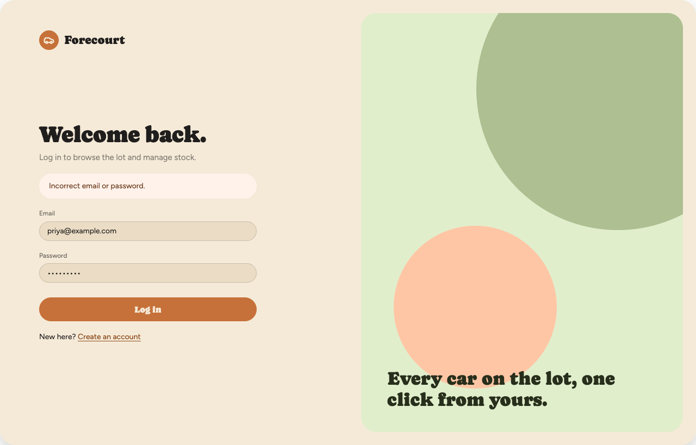
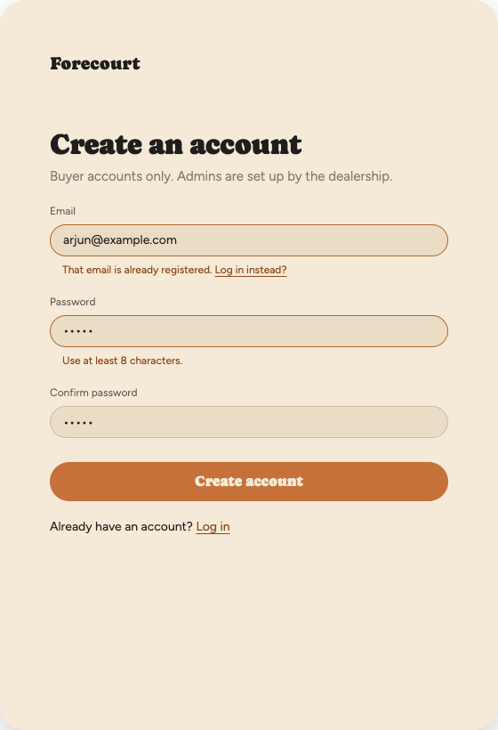
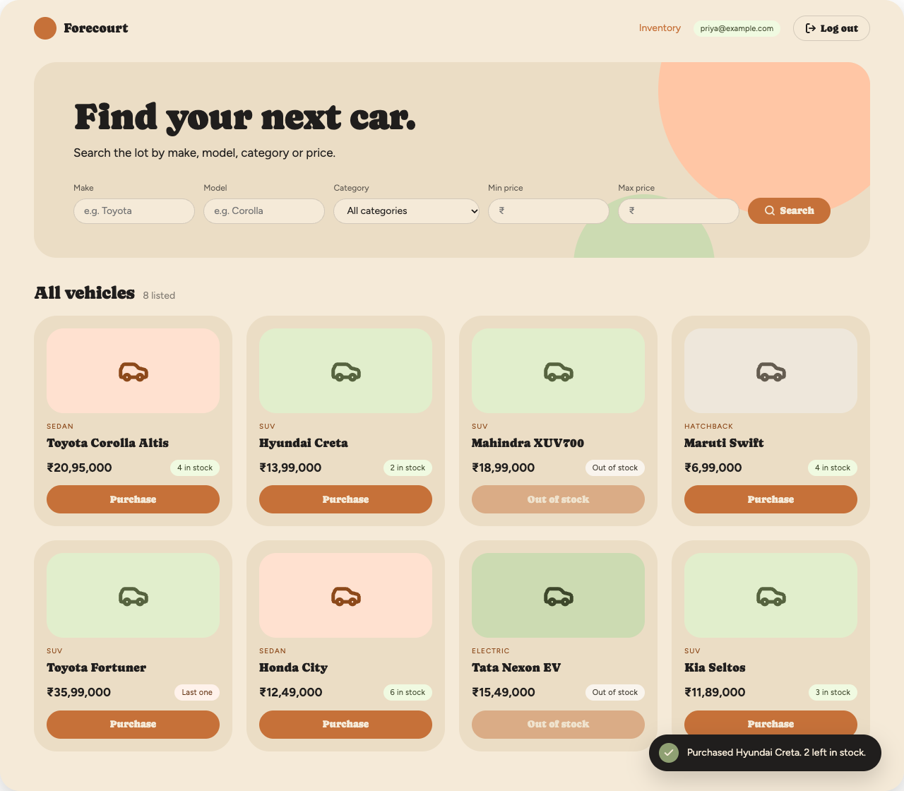
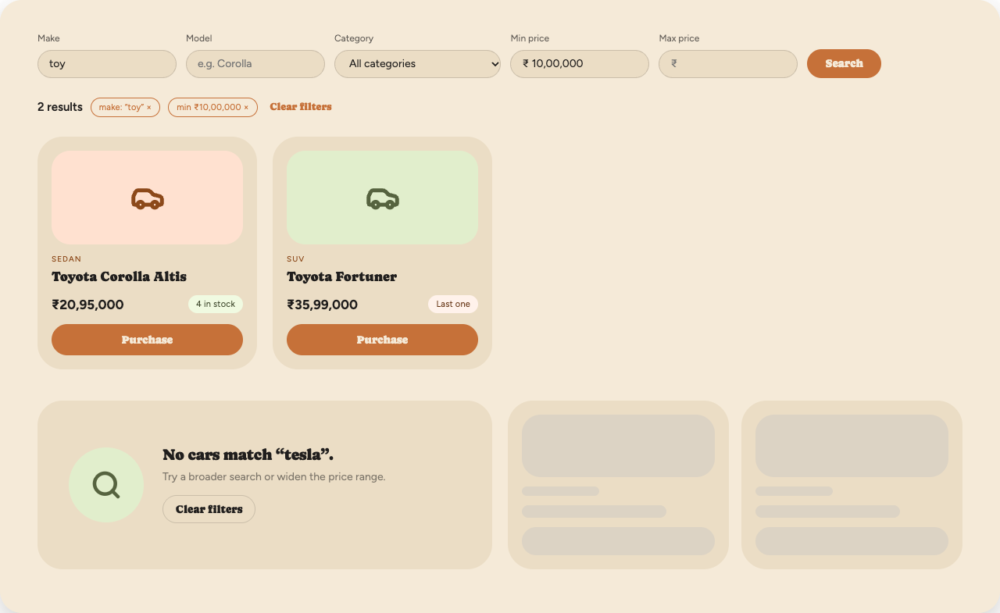
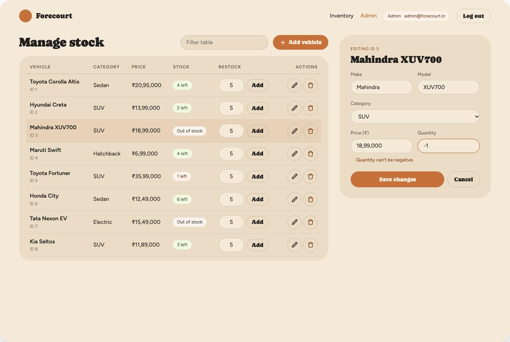
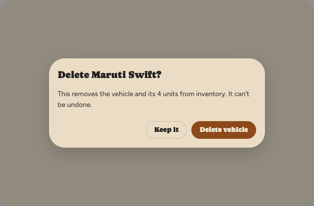
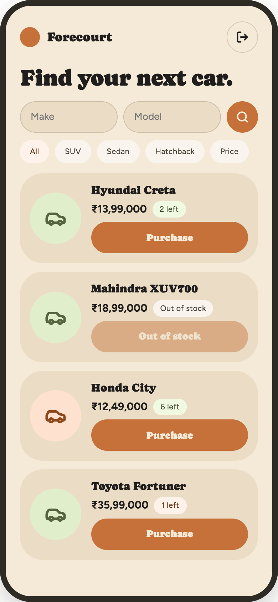

# Forecourt — UI Mockups (Phase 4)

Car dealership inventory SPA. Built on the Organic design system (Caprasimo + Figtree, terracotta + sage on cream).

## 1a. Login — `/login`
Public. Shows the API error on bad credentials (401).

## 1b. Register — `/register`
Public. Inline validation: duplicate email (409), short password (422). No admin option.

## 1c. Dashboard — `/`
Requires login. On load the app calls `GET /api/auth/me` to get the logged-in user (email shown in the nav, `is_admin` decides whether the Admin link appears — hidden for normal users). Hero with search/filter bar (separate Make and Model inputs, matching the search params), grid of `VehicleCard`s with stock badge. Purchase is disabled at quantity 0 ("Out of stock"). Toast confirms a purchase.

## 1d. Search results, empty and loading states
Partial, case-insensitive match on make ("toy" → Toyota), removable filter chips, empty state and loading skeletons.

## 1e. Admin panel — `/admin`
Requires admin. Table with inline restock, edit and delete; edit form with validation (quantity ≥ 0).

## 1f. Delete confirmation
Admin only.

## 1g. Mobile (390px)

